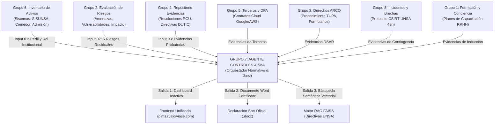

# GUÍA MAESTRA DE ARQUITECTURA, FLUJO TÉCNICO Y DEFENSA DE AUDITORÍA PIMS
## Proyecto: Sistema Multiagente de Auditoría PIMS (ISO/IEC 27701:2025) · UNSA
## Rol Asignado: GRUPO 7 — Agente de Controles y Declaración de Aplicabilidad (SoA)

---

## 1. Identidad y Misión del Grupo 7 en el Ecosistema

### 1.1 ¿Quiénes somos?
El **Grupo 7** no es un agente de recolección de campo ni un simple asistente de texto. En la arquitectura multiagente universitaria somos el **Orquestador Normativo y Juez Supremo de Auditoría**.

* **Los otros 7 grupos** recopilan datos en sus áreas de especialidad (activos, riesgos, evidencias, contratos, derechos ARCO, incidentes, capacitación).
* **El Grupo 7** recibe, cruza y somete todas esas entradas al estándar internacional de privacidad **ISO/IEC 27701:2025**, a los controles de seguridad **ISO/IEC 27001:2022** y a la **Ley N° 29733** (Ley de Protección de Datos Personales del Perú).
* **Nuestra salida oficial** es el dictamen final vinculante de la auditoría: la **Declaración de Aplicabilidad (SoA - Cláusula 6.1.3 d)** y el **Plan de Remediación de Brechas**, emitidos tanto en la plataforma web interactiva como en el documento oficial Word (`.docx`) firmado digitalmente por el Oficial de Protección de Datos (DPO) y el Director de DUTIC de la UNSA.

---

## 2. Marco Normativo y Estándares Internacionales Aplicados

Nuestro sistema implementa de forma rigurosa una jerarquía de 6 marcos normativos y metodológicos:

```
┌────────────────────────────────────────────────────────────────────────┐
│                      MARCO NORMATIVO DEL GRUPO 7                       │
├────────────────────────────────────────────────────────────────────────┤
│ 1. ISO/IEC 27701:2025 (PIMS) ──► Cláusula 6.1.3 d (SoA) y Anexo A       │
│ 2. ISO/IEC 27001:2022 (SGSI) ──► Estructura Armonizada (A.5, A.6, A.7, A.8)│
│ 3. Ley N° 29733 (Perú)       ──► Principios rectores y Datos Sensibles │
│ 4. ISO/IEC 27005 / ISO 29134 ──► Apreciación del Riesgo y DPIA (G2)    │
│ 5. ISO 19011 & Cl. 7.5       ──► Jerarquía Probatoria Documental (G4)  │
│ 6. Modelo CMMI (Niveles 0-5) ──► Medición de Madurez Institucional     │
└────────────────────────────────────────────────────────────────────────┘
```

### Detalle de cada estándar:

1. **ISO/IEC 27701:2025 (Privacy Information Management System - PIMS):**
   * Es la norma internacional insignia del proyecto.
   * **Cláusula 6.1.3 d):** Exige que la organización elabore una Declaración de Aplicabilidad (SoA) que contenga:
     - Los controles necesarios y la justificación de su inclusión.
     - Si los controles están implementados o no.
     - La justificación formal de la exclusión de cualquier control.
   * **Anexo A:** Divide los controles de privacidad según el rol institucional:
     - **Dominio A.1:** Controles exclusivos para el **Responsable del Tratamiento** (*PII Controller*).
     - **Dominio A.2:** Controles exclusivos para el **Encargado del Tratamiento** (*PII Processor*).
     - **Dominio A.3:** Requisitos y directrices comunes para ambos roles.

2. **ISO/IEC 27001:2022 (Information Security Management System - SGSI):**
   * Proporciona la línea base de seguridad de la información con sus **93 controles** organizados en 4 secciones modernas:
     - **A.5 Organizacionales:** 37 controles (políticas, roles, segregación, etc.).
     - **A.6 Personas:** 8 controles (concientización, inducción, teletrabajo).
     - **A.7 Físicos:** 14 controles (perímetros, salas de servidores, cables).
     - **A.8 Tecnológicos:** 34 controles (redes, criptografía, desarrollo seguro).

3. **Ley N° 29733 (Ley de Protección de Datos Personales del Perú):**
   * **Artículo 13 (Datos Sensibles):** Exige consentimiento previo, expreso e informado por escrito para tratar datos biométricos (como las huellas dactilares del Comedor Universitario de la UNSA).
   * **Artículo 9 (Principio de Seguridad):** Obliga a implementar medidas técnicas y organizativas para evitar filtraciones de notas en SISUNSA.
   * **Directiva de Seguridad de la ANPD:** Guía los plazos de notificación obligatoria ante brechas de seguridad (48 horas ante incidentes críticos).

4. **ISO/IEC 27005 e ISO/IEC 29134 (Gestión de Riesgos y Evaluación de Impacto en Privacidad - DPIA):**
   * Proveen la metodología para que el Grupo 2 valore los 5 riesgos residuales institucionales que justifican la obligatoriedad de los controles técnicos.

5. **ISO 19011 (Directrices para la Auditoría de los Sistemas de Gestión):**
   * Establece el principio de **evidencia objetiva y jerarquía probatoria**: un borrador preliminar en Word (`.docx`) otorga estado `parcial`, mientras que una Resolución de Consejo Universitario (`RCU`) o contrato firmado otorga estado `implementado`.

6. **Modelo de Capacidad y Madurez CMMI (Nivel 0 al 5):**
   * Mide el avance institucional: Nivel 0 (Inexistente), Nivel 1 (Inicial/Ad-hoc), Nivel 2 (Repetible/Gestionado), Nivel 3 (Definido), Nivel 4 (Medido), Nivel 5 (Optimizado).

---

## 3. Catálogo Maestro de Controles: ¿Por qué 142 controles?

Una de las preguntas seguras del jurado es: *«¿Cuántos controles auditan y cómo se componen?»*

### 3.1 La Composición Matemática de los 142 Controles:
El catálogo maestro del Grupo 7 integra la versión 2022 de ISO 27001 y la versión 2025 de ISO 27701:

| Norma de Origen | Dominio | Tipo de Controles | Cantidad |
| :--- | :--- | :--- | :---: |
| **ISO/IEC 27001:2022** | **A.5** | Controles Organizacionales | **37** |
| **ISO/IEC 27001:2022** | **A.6** | Controles sobre Personas | **8** |
| **ISO/IEC 27001:2022** | **A.7** | Controles Físicos | **14** |
| **ISO/IEC 27001:2022** | **A.8** | Controles Tecnológicos | **34** |
| **ISO/IEC 27701:2025** | **A.1** | Privacidad: Responsables (*PII Controller*) | **23** |
| **ISO/IEC 27701:2025** | **A.2** | Privacidad: Encargados (*PII Processor*) | **26** |
| **TOTAL CATÁLOGO MAESTRO** | | | **142** |

*(Nota técnica: Los controles comunes de privacidad del Anexo A.3 de ISO 27701 son extensiones semánticas de los controles de seguridad A.5 a A.8, por lo que el sistema los mapea directamente a sus identificadores canónicos para evitar filas redundantes).*

---

### 3.2 ¿Por qué aplican exactamente 124 controles a la UNSA?

La regla de oro de ISO/IEC 27701:2025 radica en la **distinción de roles**:

* **La UNSA actúa como Responsable del Tratamiento (`PII Controller`):**
  * La universidad decide por sí misma qué datos recopilar, cómo evaluarlos y para qué usarlos en sus sistemas propios (SISUNSA, Comedor Universitario, Admisión).
  * Por tanto:
    $$\text{Controles Aplicables} = 93 \text{ (ISO 27001)} + 23 \text{ (A.1 Responsable)} + 8 \text{ (Comunes A.3)} = \mathbf{124 \text{ Controles}}$$
* **Los 26 Controles de A.2 (`PII Processor`):**
  * Quedan formalmente **EXCLUIDOS (No Aplica)** de la SoA.
  * *Justificación de exclusión:* «La UNSA no realiza tratamiento por encargo exclusivo de terceras entidades externas; actúa como entidad titular responsable de los bancos de datos universitarios».

---

## 4. El Ecosistema Multiagente: Cómo interactuamos con los otros grupos

El Grupo 7 es el receptor y validador de los resultados de todos los agentes del salón:



---

## 5. El Flujo Algorítmico Paso a Paso: ¿Cómo se genera la SoA?

Cuando el usuario hace clic en **«Ejecutar Auditoría y Generar SoA Oficial»** en la web o cuando n8n envía la orden al endpoint `POST /api/controles/ejecutar`, el motor interno (`agents/controles.py` + `docx_builder.py`) ejecuta un pipeline determinista en 7 etapas:

```
┌────────────────────────────────────────────────────────────────────────┐
│                        PIPELINE ALGORÍTMICO G7                         │
├────────────────────────────────────────────────────────────────────────┤
│ 1. Ingesta de Payloads ──► Validación de esquemas JSON (3 bloques)    │
│ 2. Filtro de Rol       ──► Evaluación booleana _aplica(c, rol)         │
│ 3. Cruce de Riesgos    ──► Vinculación de códigos (RSK-UNSA-01..05)    │
│ 4. Estado Probatorio   ──► Jerarquía ISO 19011 (implementado/parcial)  │
│ 5. Cruce RAG (FAISS)   ──► Cita de artículos de directivas internas    │
│ 6. Cálculo Métrico     ──► CMMI y porcentaje de cumplimiento           │
│ 7. Emisión Dual        ──► JSON reactivo web + Word (.docx) formateado │
└────────────────────────────────────────────────────────────────────────┘
```

### Etapa 1: Ingesta de las 3 Entradas Oficiales
El agente recibe el payload estructurado:
1. **Input 01 (Perfil Institucional):** Define la entidad auditada (*UNSA*) y su rol (*responsable*).
2. **Input 02 (Matriz de Riesgos):** Los 5 riesgos residuales con su severidad (`CRÍTICO`, `ALTO`, `MEDIO`) y los controles ISO que deben mitigarlos.
3. **Input 03 (Repositorio Probatorio):** Las 14 evidencias universitarias clasificadas por área emisora.

### Etapa 2: Regla de Aplicabilidad (`_aplica`)
Por cada uno de los 142 controles:
* Si `rol == 'responsable'` y el control pertenece al dominio `A.2`, devuelve `aplica = False` con la justificación de exclusión.
* Si pertenece a `A.1`, `A.5`, `A.6`, `A.7` o `A.8`, devuelve `aplica = True`.

### Etapa 3: Cruce con Riesgos Residuales
El agente busca si el identificador del control está en la lista de controles mitigadores de algún riesgo:
* Si el control es `A.1.2.6` (DPIA), detecta que está vinculado al riesgo crítico `RSK-UNSA-02` (Huellas del Comedor sin DPIA).
* Concatena automáticamente a la justificación técnica: *«Justificado por Apreciación de Riesgos: Vinculado a RSK-UNSA-02»*. Esto cumple con la Cláusula 6.1.3 d) de ISO 27701.

### Etapa 4: Determinación de la Jerarquía Probatoria (`_estado`)
El agente evalúa los documentos probatorios asociados al control:
* Si existe al menos un documento formal aprobado (Resolución `RCU`, contrato firmado o directiva vigente) ──► Estado = **`implementado`** (Verde).
* Si no hay resolución aprobada pero existe un documento de trabajo o borrador (`.docx`, versión `v0.2`) ──► Estado = **`parcial`** (Amarillo).
* Si el control es aplicable pero no cuenta con ningún documento probatorio en el repositorio ──► Estado = **`no implementado` (Brecha Crítica)** (Rojo).

### Etapa 5: Cruce Semántico Vectorial con RAG y FAISS (`rag.py`)
El motor de embeddings (`sentence-transformers/all-MiniLM-L6-v2`) indexado en **FAISS** analiza la Política General de Privacidad de la UNSA y las directivas internas (`DIR-OTIC-004-UNSA`):
* Asocia al control la cita legal exacta: ej. *«Directiva DIR-OTIC-004-UNSA, Art. 7 (Cuentas de acceso y uso aceptable)»*.

### Etapa 6: Cálculo de Madurez Institucional CMMI
* De **124 controles aplicables**:
  * **11 Implementados** (~8.9%)
  * **2 Parciales** (~1.6%)
  * **111 Brechas Críticas** (89.5%)
* La madurez CMMI ponderada da un resultado de **Nivel 0.2 / 5.0**.

> [!IMPORTANT]
> **¿Por qué el Nivel 0.2 es una fortaleza en la exposición?**
> En un análisis inicial de brechas (*Gap Analysis*), una institución pública que recién audita la norma internacional no puede inventar un nivel de madurez 3 o 4. El nivel 0.2 refleja la **realidad objetiva universitaria** sustentada en evidencias reales: se tiene seguridad perimetral y políticas generales de TIC (11 controles), pero faltan procedimientos formales de privacidad (111 brechas). Esto justifica de forma contundente la necesidad del Plan de Remediación.

### Etapa 7: Emisión del Documento Word Oficial (`docx_builder.py`)
El módulo clona la plantilla oficial docente, inyecta los 142 controles en la Tabla 2 con su formato institucional, rellena los riesgos residuales en la Tabla 3 y aplica el saneamiento normativo:
* Elimina autores de plantilla previos (`Dejan Kosutic`) e inserta a la **DUTIC** y la **OPD**.
* Actualiza el alcance a **ISO/IEC 27001:2022 e ISO/IEC 27701:2025 (PIMS) y Ley N° 29733**.
* Resuelve los bloques de firma con el **DPO / Director de DUTIC de la UNSA**.

---

## 6. Las Dos Skills Formales del Grupo 7: Paradigma «De Prompt a Skill»

Para el docente Mg. Edward Zárate, un agente no puede ser una caja negra gobernada por prompts sueltos. Nuestro agente opera bajo dos **Skills formales** especificadas en YAML y esquemas JSON:

### 1. SKILL-01: `generar-soa` (`skills/generar-soa/SKILL.md`)
* **Propósito:** Orquestación y evaluación masiva determinista de los 142 controles.
* **Disparador:** Llamada desde la web o webhook de n8n.
* **Herramientas internas:** Motor de reglas de aplicabilidad, evaluador de estado probatorio, retriever vectorial FAISS y analizador de matriz de brechas.
* **Salida:** Payload SoA canónico completo + generación del archivo Word oficial.

### 2. SKILL-02: `verificar-controles` (`skills/verificar-controles/SKILL.md`)
* **Propósito:** Inspección granular y quirúrgica de un control individual.
* **Caso de uso:** Auditar únicamente el control `A.1.2.6` (DPIA en Comedor Universitario) para emitir recomendaciones técnicas inmediatas a la Dirección de Bienestar Universitario.

---

## 7. Las 4 Pestañas de la Interfaz Web Oficial (`pims.rvaldiviase.com`)

| Pestaña | Nombre | Qué Demuestra al Jurado |
| :---: | :--- | :--- |
| **1** | **Entradas del Sistema (Inputs)** | Muestra la ingesta estructurada de los 5 activos de G6, los 5 riesgos de G2 y las 14 evidencias de las áreas universitarias (DUTIC, Legal, OPD, CSIRT, RRHH). Permite seleccionar el rol (`Responsable`, `Encargado`, `Ambos`). |
| **2** | **Dashboard Ejecutivo & SoA Oficial** | Presenta los KPIs ejecutivos (142 evaluados, 124 aplican, 11 implementados, 111 brechas, Madurez 0.2/5), botón de descarga directa del Word (`.docx`), filtros por color (`🔴`, `🟢`, `🟡`, `⚪`), la Tabla 2 Oficial SoA y la Tabla 3 de Riesgos Residuales. |
| **3** | **Base Normativa & RAG (Chat FAISS)** | Chatbot normativo conectado a FAISS que permite consultar en lenguaje natural sobre las directivas institucionales (`DIR-OTIC-004-UNSA`, TUPA, derechos ARCO) con porcentajes de afinidad semántica. |
| **4** | **Catálogo Maestro (142 Controles)** | Vista completa del marco normativo internacional con selector de dominios (`A.5`, `A.6`, `A.7`, `A.8`, `A.1`, `A.2`) y concordancia con los artículos de la Ley N° 29733. |

---

## 8. Guion y Respuestas Estratégicas para la Exposición

### Pregunta 1: *«¿Por qué su agente es un agente de IA y no un simple programa en Python?»*
> **Respuesta:**
> *«Nuestro agente no es un script rígido ni un chatbot conversacional ciego. Implementa una arquitectura híbrida neuro-simbólica: utiliza un **motor determinista basado en Skills** (`generar-soa`) para garantizar que la lógica normativa y legal sea reproducible y libre de alucinaciones, combinado con un **motor RAG semántico sobre embeddings vectoriales (FAISS)** que interpreta el lenguaje natural de las resoluciones universitarias de la UNSA y las conecta con las directivas institucionales y la Ley N° 29733.»*

### Pregunta 2: *«¿Por qué la madurez institucional sale en 0.2 y tienen 111 brechas?»*
> **Respuesta:**
> *«Porque este informe es un **diagnóstico inicial de brechas (Gap Analysis)** auténtico. La UNSA cuenta actualmente con directivas generales de seguridad y conectividad de TIC (11 controles implementados por DUTIC), pero como ocurre en la mayoría de universidades públicas del país, carece de evaluaciones de impacto de privacidad (DPIA), contratos de tratamiento de datos con terceros y procedimientos formales PIMS. Declarar una madurez de Nivel 3 o 4 sería falsear la auditoría; el Nivel 0.2 sustenta científicamente ante el Consejo Universitario y la ANPD el Plan de Remediación.»*

### Pregunta 3: *«¿Cómo garantizan que la IA no tome decisiones legales por sí sola?»*
> **Respuesta:**
> *«Aplicamos el principio fundamental de **Supervisión y Gobernanza Humana (Human-in-the-Loop)** respaldado por la Cláusula 6.1.3 de ISO 27701. Nuestro sistema genera el dictamen técnico y la maqueta probatoria, pero la validez jurídica institucional definitiva exige la firma digital y ratificación del Oficial de Protección de Datos (DPO) y del Director de DUTIC, tal como se especifica en la cabecera y pie del documento oficial exportado.»*
