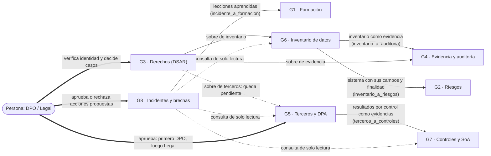
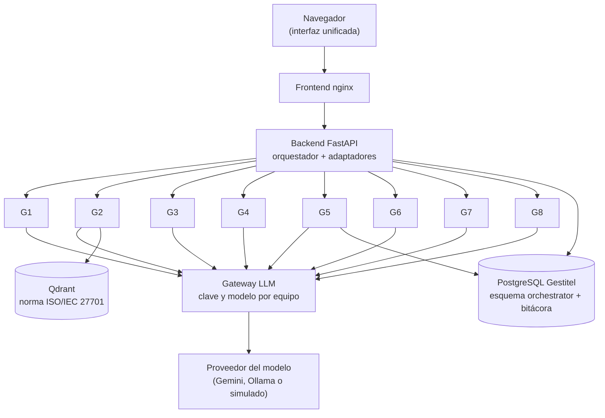

# Comunicación entre agentes

Qué agentes se relacionan y cómo. Ninguna conexión modifica el código de un agente: todas pasan por el orquestador (que transforma los datos en la frontera) o son consultas de solo lectura.

## 1. Relaciones entre agentes

Línea continua = flujo orquestado (cada paso es una ejecución real del agente). Línea punteada = consulta de solo lectura o entrega que espera a una persona. Línea gruesa = decisión humana en `/revision`.

## 2. Quién participa en qué

| Flujo | Origen | Destino | Datos que viajan |
|---|---|---|---|
| `incidente_a_formacion` | G8 | G1 | Lecciones aprendidas del informe, sin datos personales |
| `terceros_a_controles` | G5 | G7 | Estado de cada control (Cumple → implementado, Parcial → parcial) |
| `inventario_a_auditoria` | G6 | G4 | Documento de evidencia con su SHA-256, sin valores de datos |
| `inventario_a_riesgos` | G6 | G2 | Nombres de campos, categorías, finalidad y titulares; nunca valores |
| `dsar_handoffs` | G3 | G4 / G6 / G5 | Sobres de handoff generados tras una decisión humana; el de G5 queda pendiente |
| Conectores de G8 | G8 | G5 / G6 / G7 | Consultas HTTP de solo lectura; las rutas que cambian estado están bloqueadas |

Los ocho agentes participan en al menos un flujo. G7 y G1 solo reciben; G2 solo recibe de G6; G8 y G3 son los que más envían.

## 3. Arquitectura que lo hace posible

- El **orquestador** registra cada ejecución, evento y handoff en PostgreSQL y deja una fila de metadatos (sin datos de entrada ni salida) en `demo.core_securitylog`.
- Todas las llamadas al modelo pasan por el **gateway**, que usa la clave de Gemini de cada equipo.
- Los demás agentes conservan su propio almacén (SQLite, archivos, n8n) y no se tocan.
